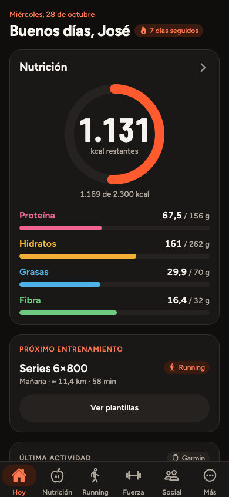
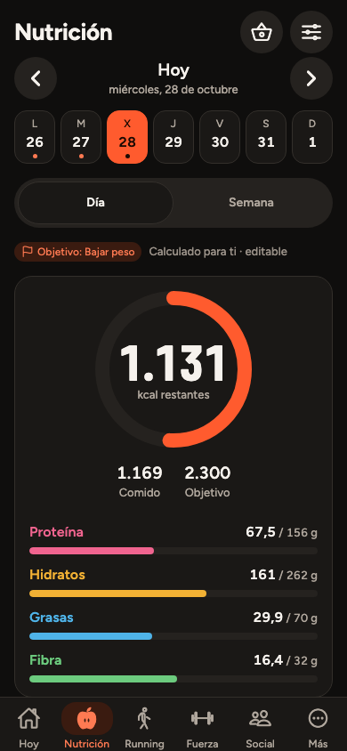
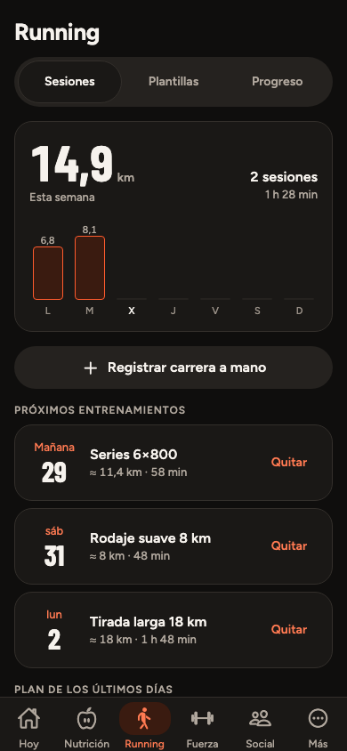
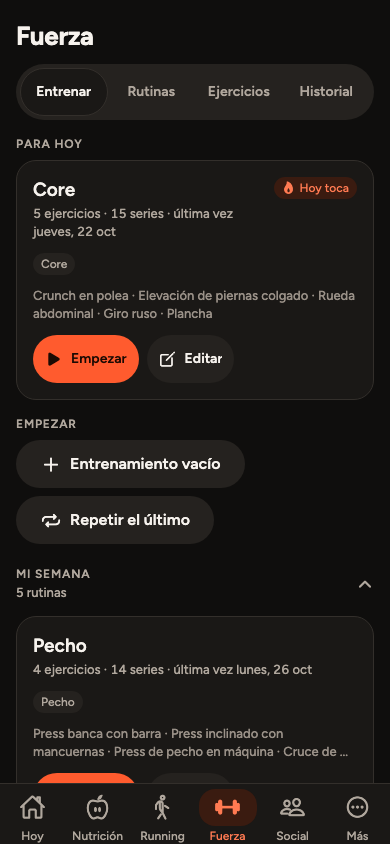
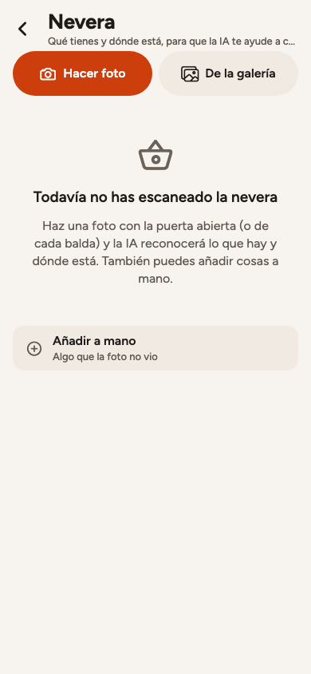
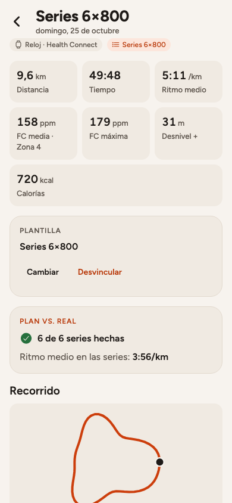
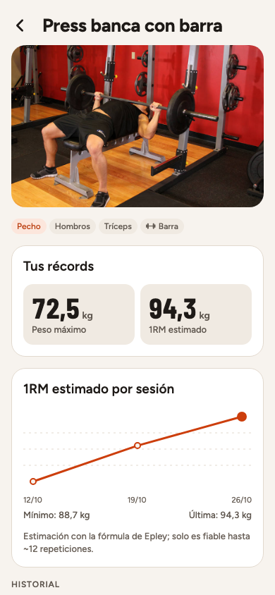
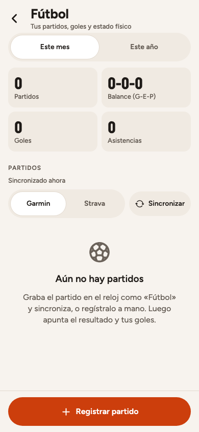
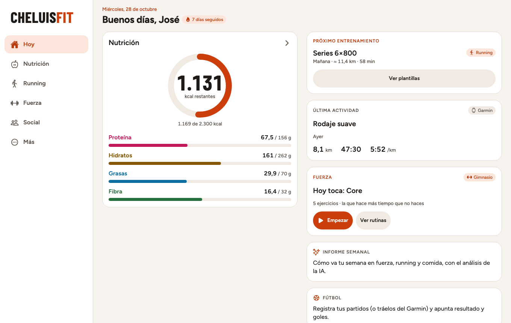
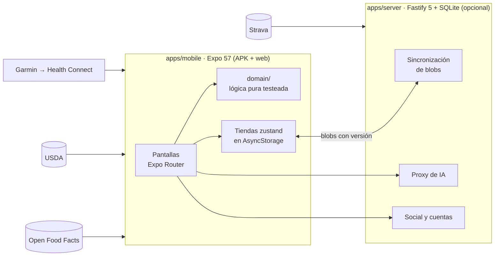

# CheluisFIT

[](LICENSE)
[](https://github.com/jlgarciavalverde/cheluisfit-app/releases)


[](https://cheluisfit.redgarverde.com)

**Una app de fitness completa (nutrición, running y fuerza) para mí, mis amigos y mi familia.** Android nativo con APK propio (sin tiendas) y web, con los datos **primero en el dispositivo** y sincronización opcional con un servidor propio.

| Hoy | Nutrición | Running | Fuerza |
|---|---|---|---|
|  |  |  |  |

<details>
<summary><b>Más capturas</b> (nevera, sesión, ejercicio, fútbol y escritorio)</summary>

| Nevera | Sesión de running | Ejercicio | Fútbol |
|---|---|---|---|
|  |  |  |  |



</details>

*Capturas reales de la versión 0.21.0 con los datos de ejemplo.*

## Qué hace

| | |
|---|---|
| 🥗 **Nutrición** | Diario con kcal y macros, objetivo con **TDEE adaptativo** (se corrige según tu peso real, siempre con tu confirmación), peso y medidas, escáner de código de barras con **Open Food Facts**, buscador con **USDA** (+600.000 alimentos y platos caseros españoles), alta por **foto con IA** y **nevera 3D**. |
| 🏃 **Running** | Carreras y caminatas, plantillas (series, rodajes, tiradas), plan semanal, récords (5K, 10K, media) y gráficas. Importación desde **Garmin** (Android Health Connect) o **Strava** (con recorrido GPS). |
| 🏋️ **Fuerza** | Rutinas con progresión de cargas, **~2.500 ejercicios** con foto o GIF, entreno en curso con descanso y notificación, 1RM y «repetir el último entreno». |
| ⚽ **Fútbol** | Partidos desde Health Connect o a mano, con resultado, goles, asistencias y resumen del mes. |
| 🤖 **IA** | Asistente con tu contexto real (Gemini, con Groq de respaldo) que **propone** y tú confirmas, análisis al terminar un entreno o una carrera e informe semanal. |
| 👥 **Social** | Perfiles públicos o privados, seguir, feed con posts de una carrera o un entreno (con una copia, no tus datos), likes, comentarios y avisos. |
| 📴 **Local primero** | Funciona sin cuenta y sin red. Con cuenta, sincroniza entre dispositivos con versionado optimista. Exportación a JSON. |

## Cómo funciona



Todo vive en el móvil. El servidor guarda una copia de cada tienda como un bloque entero, sin interpretarla, y las claves de IA nunca salen de él. Detalle en [arquitectura](docs/arquitectura.md) y [flujos](docs/flujos.md).

| Pieza | Tecnología |
|---|---|
| App | Expo 57 / React Native 0.86, Expo Router, zustand, three.js (nevera 3D) |
| Servidor | Fastify 5, Node 22 (`node:sqlite`), Zod, Vercel AI SDK (Gemini + Groq) |
| Integraciones | Open Food Facts, USDA FoodData Central, Android Health Connect, Strava OAuth2 |
| Calidad | vitest (~300 tests de lógica + servidor), Playwright + axe (~156 e2e) con capturas de referencia, ESLint |

## Empezar

Requisitos: Node 22 y pnpm.

```bash
pnpm install
cd apps/mobile
npx expo start --web          # navegador: http://localhost:8081
npx expo start --android      # emulador Android
```

| Comando (en `apps/mobile`) | Qué hace |
|---|---|
| `pnpm typecheck && pnpm test` | Tipos y lógica |
| `pnpm e2e` | Exporta la web y pasa Playwright + axe |
| `cd ../server && pnpm test` | Tests del servidor |

Para Health Connect y las notificaciones hace falta un APK o *development build* (`npx expo run:android`): Expo Go no basta. Más en [operaciones](docs/operaciones.md).

## Estructura

```
apps/mobile/src
  app/         rutas (Expo Router): (tabs)/ = Hoy, Nutrición, Running, Fuerza, Social, Más
  components/  ui/ = sistema de diseño; nutrition/, running/, fridge/, ai/, social/…
  domain/      lógica pura sin React Native (objetivos, TDEE, nutrientes, GTIN, running, análisis)
  data/        tiendas (zustand + AsyncStorage), datos de ejemplo y clientes de red
apps/server/src
  db.ts, auth.ts, app.ts, routes/   cuentas, blobs, fotos, IA, Strava y social
tools/         despliegue y copias externas
```

## Documentación

Índice completo en [docs/](docs/README.md).

| Para… | Lee |
|---|---|
| Entender qué hace | [Requisitos](docs/requisitos.md) · [Flujos](docs/flujos.md) |
| Entender cómo está hecho | [Arquitectura](docs/arquitectura.md) · [Diseño del modo social](docs/plan-social.md) |
| Desplegar, copias y restaurar | [Operaciones](docs/operaciones.md) |
| Programar en el repo | [AGENTS.md](AGENTS.md): decisiones finas y trampas conocidas |

## Próximos pasos

- Probar en un móvil real lo de las versiones 0.18–0.21 (nevera 3D, análisis con IA, perfil público, avisos, recuperar contraseña y fútbol).
- Avisos push del modo social (hoy van a una bandeja dentro de la app).
- Vídeos propios de los ejercicios de fuerza.
- Recorrido GPS sin Strava, importando el GPX que exporta Garmin Connect.

## Licencia

Código bajo [MIT](LICENSE) © José Luis García Valverde. Los datos de terceros (Open Food Facts, USDA, catálogo de ejercicios y GIF) conservan sus propias licencias: ver [NOTICE.md](NOTICE.md).
