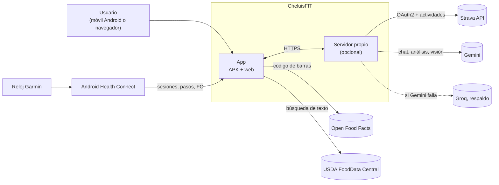
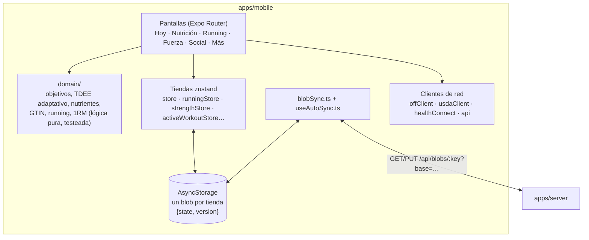
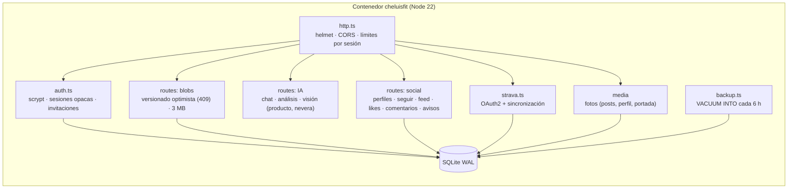
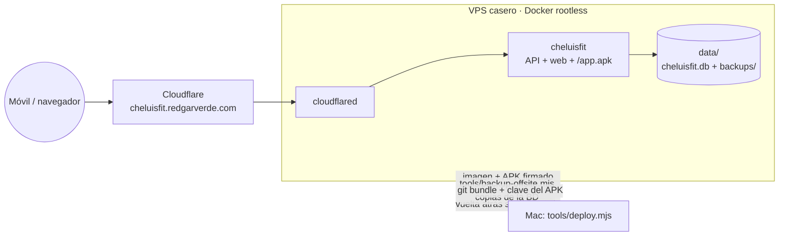
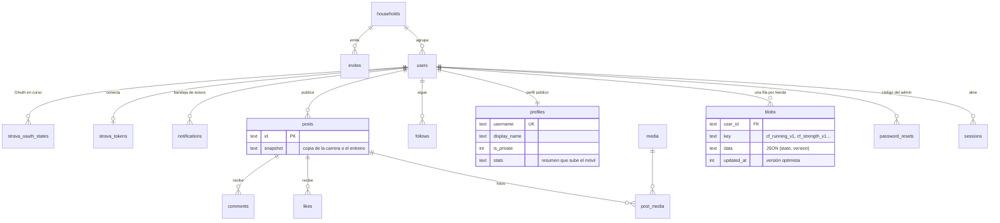

# Arquitectura

[← Documentación](README.md) · [README del proyecto](../README.md)

CheluisFIT es un monorepo pnpm con dos aplicaciones. Las decisiones finas y las trampas conocidas están en [`AGENTS.md`](../AGENTS.md); aquí va la visión de conjunto con diagramas.

| Paquete | Qué es |
|---|---|
| `apps/mobile` | Expo 57 / React Native con Expo Router. Una sola base de código para el APK de Android y la web. Lógica pura en `src/domain`, estado en tiendas zustand persistidas en AsyncStorage. |
| `apps/server` | Fastify 5 sobre Node 22 con `node:sqlite`. Opcional: cuentas, sincronización de blobs, fotos, proxy de IA, Strava y modo social. Sirve también la web y el APK. |

## Contexto

## Local primero

La app funciona entera sin cuenta y sin red. Todo vive en el dispositivo y el servidor solo guarda copias.

El servidor guarda **el blob entero de cada tienda**, sin normalizar en tablas. Así el esquema del móvil puede evolucionar (con las migraciones de zustand `persist`) sin tocar el servidor, y el servidor nunca interpreta los datos de fitness de nadie.

## Servidor

## Despliegue

## Modelo de datos del servidor

## Decisiones

| Decisión | Por qué |
|---|---|
| Local primero | La app tiene que funcionar en el gimnasio sin cobertura y sin crear cuenta. |
| Blobs enteros en lugar de tablas | Un solo esquema que mantener (el del móvil) y un servidor que no lee datos de salud. |
| Versionado optimista y «gana el servidor» | El uso real es casi siempre un solo móvil. Lo local que pierde se guarda en `cf_conflict_backup_<clave>` y se puede recuperar. Un entreno en curso nunca se pierde. |
| La IA propone, el usuario confirma | El asistente nunca escribe nada por su cuenta. |
| IA en el servidor con respaldo | Las claves no viajan en el APK. Si Gemini falla, responde Groq. |
| Posts con snapshot | Compartir una carrera no expone el historial: el post lleva una copia y el servidor nunca lee el blob de otro usuario. |
| APK propio, sin tiendas | Uso personal y de familia. Se instala desde `/app.apk?v=<versión>` (con `?v=` para saltarse la caché de Cloudflare). |
| Expo con módulos nativos | Health Connect y las notificaciones de descanso necesitan un APK propio: Expo Go no basta. |
