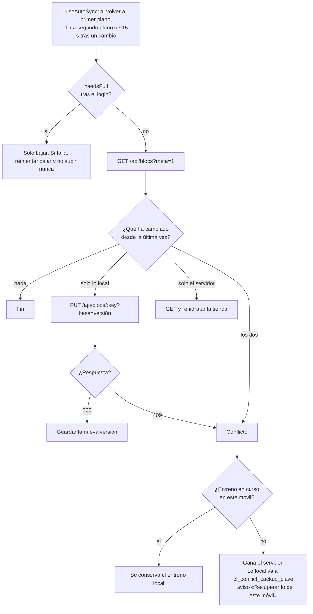
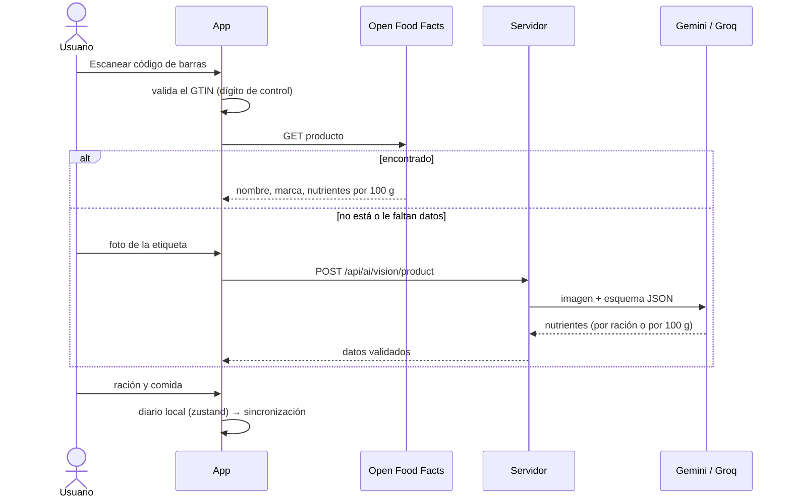
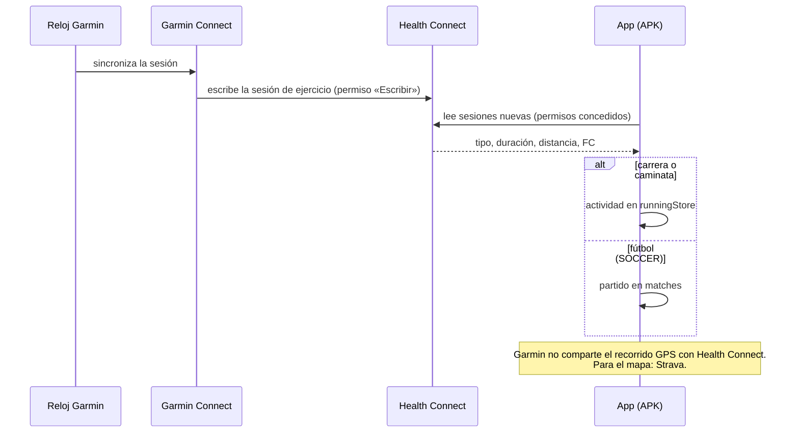
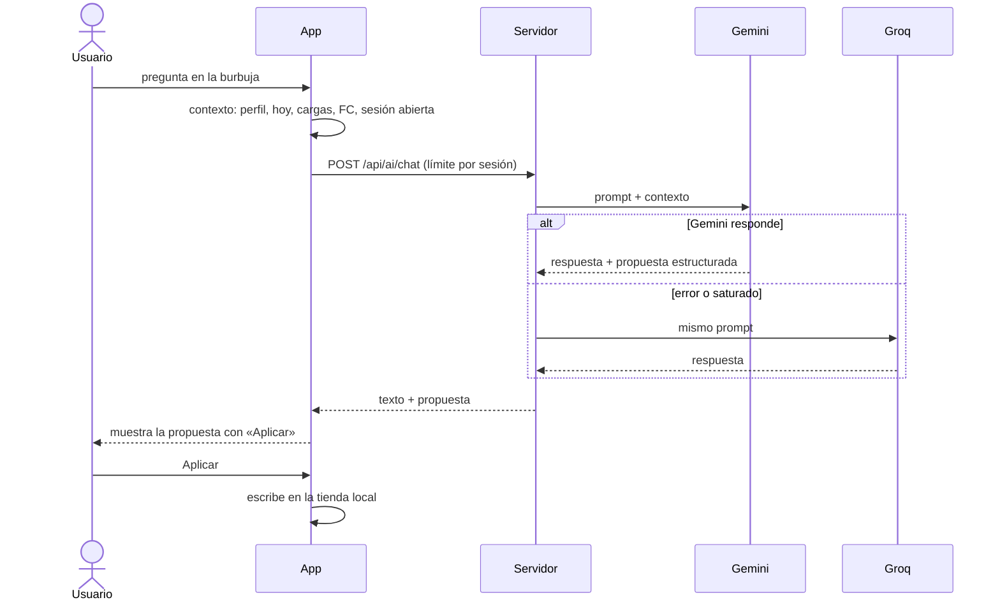
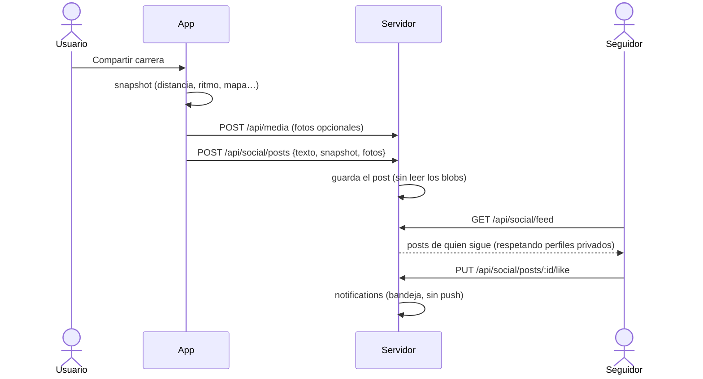

# Flujos principales

[← Documentación](README.md) · [README del proyecto](../README.md)

## Sincronización de un blob

`cf_sync_meta_v1` guarda, por clave, la última versión del servidor y una huella del JSON local de cuando coincidían. Con eso, `syncBlobs()` sabe quién ha cambiado.

## Escanear un alimento

## Importar actividad de Garmin

## Asistente de IA

## Publicar en el feed

